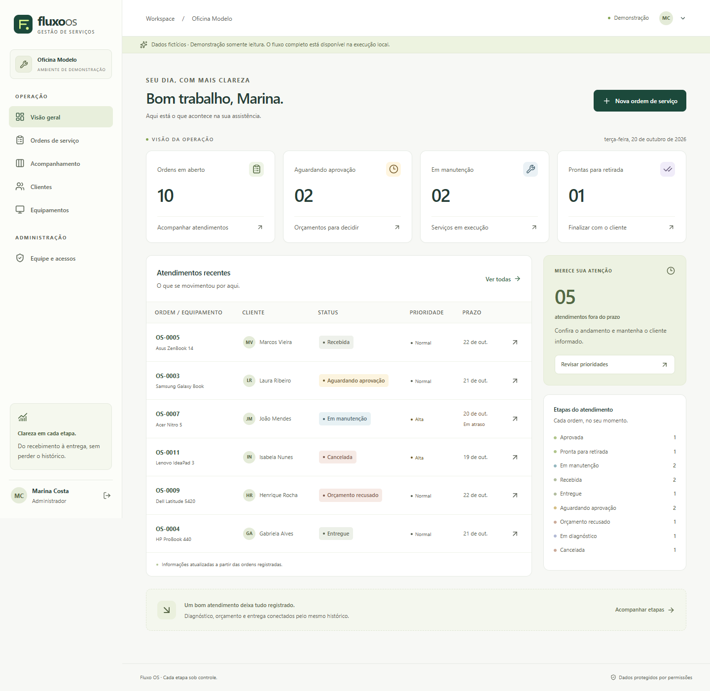
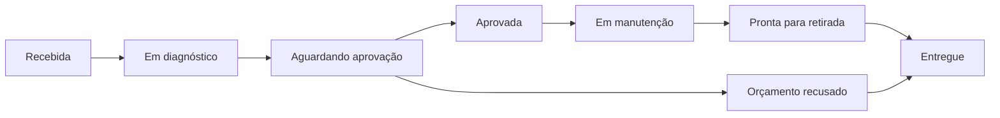
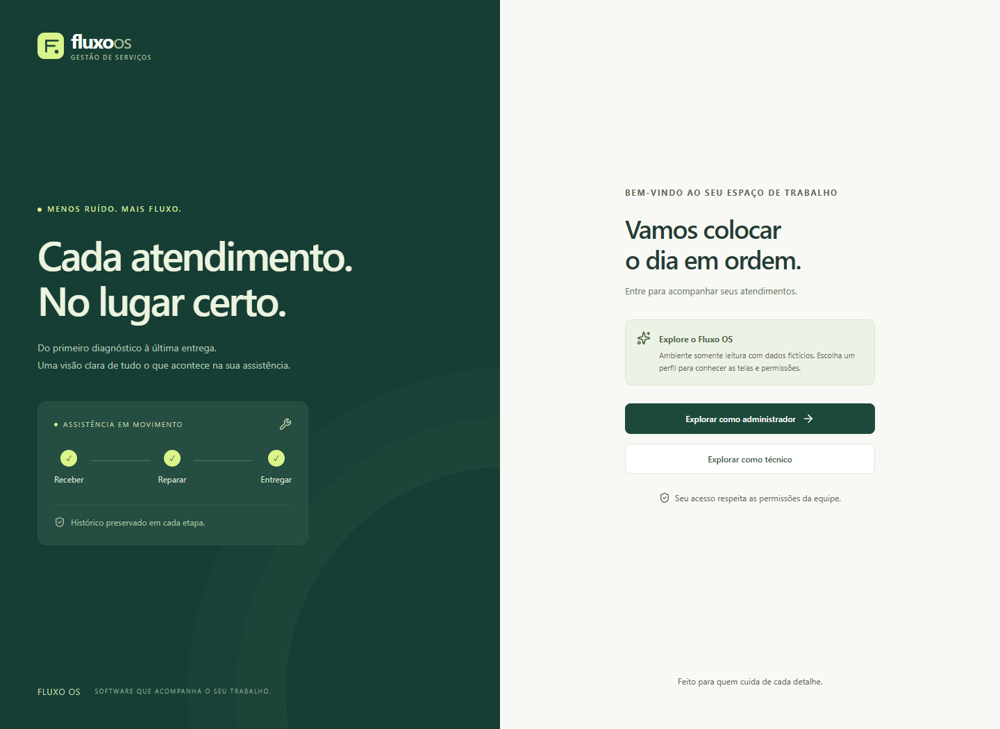
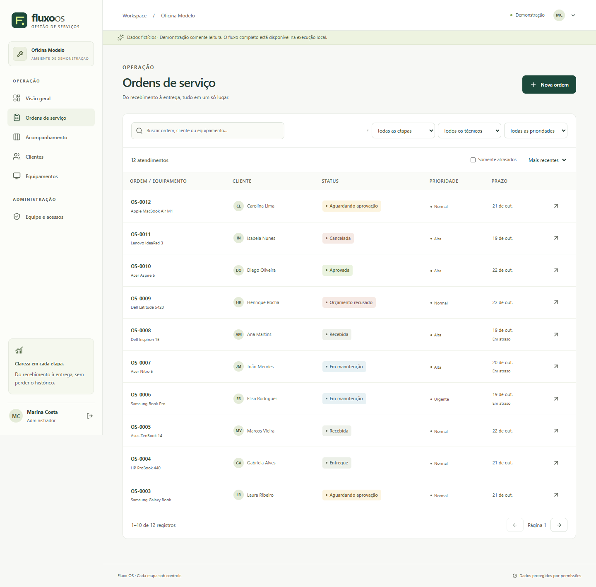
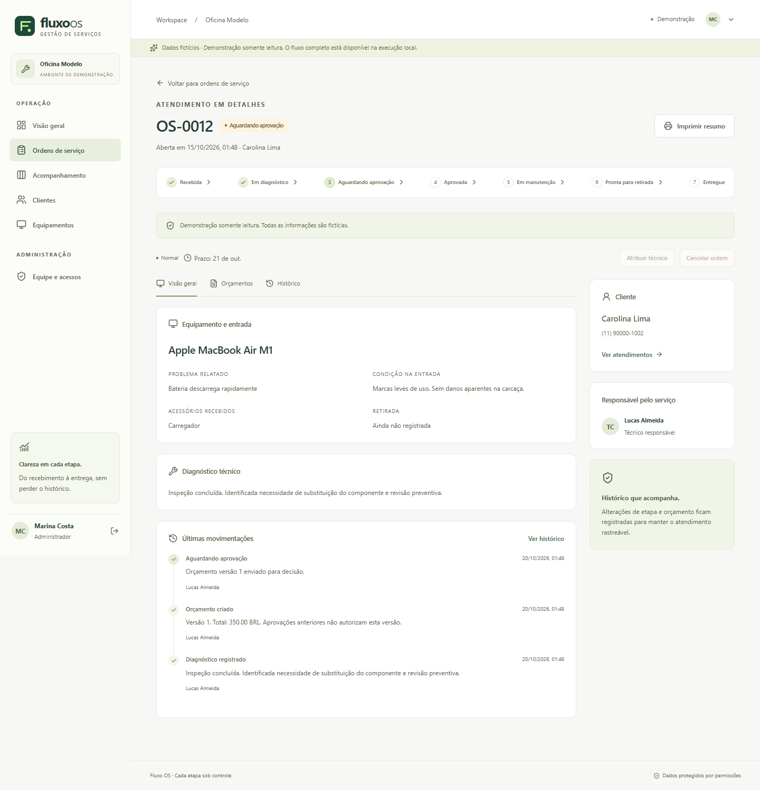
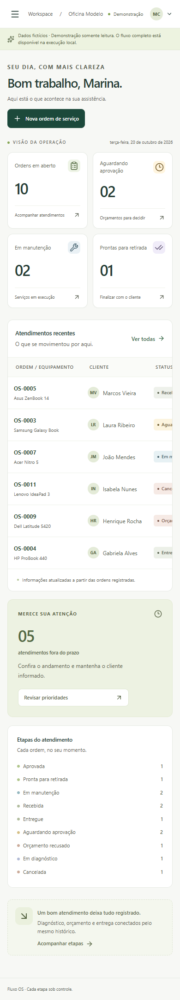
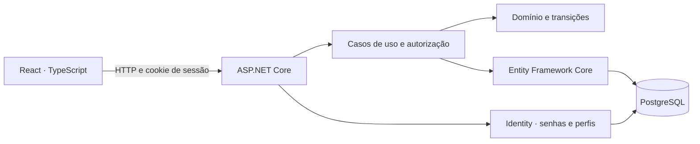

<div align="center">

# Fluxo OS

**Do primeiro atendimento à entrega, cada etapa sob controle.**

Gestão de ordens de serviço para assistências técnicas de computadores e notebooks.

[](https://github.com/duduescudero/fluxo-os/actions/workflows/quality.yml)


[Executar](#execute-com-docker) · [Regras de negócio](#um-fluxo-com-regras) · [Arquitetura](docs/architecture.md) · [Testes](docs/testing.md)

</div>



## O problema

Uma assistência precisa saber quem deixou um equipamento, o que foi identificado, qual orçamento foi aprovado e quando o serviço pode avançar. Quando essas informações ficam espalhadas, o atendimento perde contexto.

O Fluxo OS reúne esse caminho em uma aplicação web: **cliente → equipamento → diagnóstico → orçamento → reparo → entrega**. Uma linha do tempo preserva as decisões, e o backend impede que uma etapa importante seja ignorada.

Projeto pessoal de portfólio, com dados fictícios. Não representa uma assistência em operação ou clientes reais.

## Execute com Docker

Requisitos: **Git e Docker Desktop com containers Linux em execução**. Não é necessário instalar Node, .NET ou PostgreSQL no computador para este fluxo.

```powershell
git clone https://github.com/duduescudero/fluxo-os.git
cd fluxo-os
powershell.exe -NoProfile -ExecutionPolicy Bypass -File scripts/start.ps1
```

Abra **http://localhost:8080**. O script cria senhas aleatórias locais, prepara a aplicação e o banco, aplica as migrações e mostra o acesso no seu terminal. A primeira execução baixa as imagens e compila o projeto.

| Perfil | E-mail local |
| --- | --- |
| Administrador | `admin@fluxo.example` |
| Técnico | `tecnico@fluxo.example` |
| Segundo técnico | `tecnico2@fluxo.example` |

A senha inicial fica no arquivo `.env`, ignorado pelo Git. Não existe senha padrão de produção. Os endereços `.example` são fictícios e não recebem e-mail.

No Linux/macOS: `sh scripts/start.sh` — requer Docker Compose e OpenSSL.

Para conhecer a experiência **somente leitura**, com seleção de perfil na entrada:

```powershell
powershell.exe -NoProfile -ExecutionPolicy Bypass -File scripts/start.ps1 -ReadOnly
```

Os dados continuam no PostgreSQL após reiniciar. Para parar, use `docker compose stop`. Os scripts não removem volumes nem apagam seus registros.

> A demonstração está disponível para execução local. Não há uma hospedagem pública contratada ou anunciada neste momento.

## Um fluxo com regras



- **Diagnóstico exige um responsável.** O equipamento não começa a avaliação sem técnico atribuído.
- **Manutenção exige aprovação.** Enviar uma requisição direta à API não permite pular o orçamento.
- **Revisar invalida a autorização anterior.** O orçamento ganha uma nova versão; a versão aprovada permanece no histórico e não autoriza os novos valores.
- **O total pertence ao servidor.** Quantidades e valores são validados; cálculos usam `decimal`, sem ponto flutuante para dinheiro.
- **Entrega registra quem retirou.** Orçamentos recusados permitem devolução sem simular um reparo realizado.
- **Cancelamento exige justificativa e administrador.** Uma ordem encerrada não é reaberta silenciosamente; observações de correção ficam como novos eventos.
- **Uma edição não pode apagar a outra.** Tokens de versão retornam conflito quando a informação mudou em outra sessão.

A aprovação é um **registro interno feito pelo funcionário**, indicando canal, data e observação. Não equivale a assinatura digital ou confirmação autenticada do cliente.

[Tabela completa de transições e permissões](docs/business-rules.md).

## O que você pode explorar

| Área | Recursos |
| --- | --- |
| Visão geral | Indicadores calculados do banco, atendimentos recentes, atrasos e distribuição por etapa. |
| Ordens | Busca, filtros, paginação, prioridade, responsável e prazo. |
| Atendimento | Diagnóstico, acessórios, condição de entrada, orçamento versionado, histórico e resumo para impressão. |
| Acompanhamento | Quadro das etapas com cartões e navegação para cada ordem. |
| Clientes e equipamentos | Cadastro, edição, arquivamento, reativação e acesso ao histórico. |
| Equipe | Criação de acessos, perfis, desativação e proteção do último administrador ativo. |

O administrador acompanha toda a operação. O técnico consulta e trabalha nos atendimentos atribuídos a ele. As restrições são aplicadas na API, inclusive para leitura por identificador.

<details>
<summary><strong>Conheça outras telas</strong></summary>

### Entrada


### Ordens


### Atendimento


### Celular


</details>

As imagens são capturas da aplicação executada com dados fictícios, não layouts conceituais.

## Arquitetura e escolhas



**Monólito modular:** quatro projetos .NET separam domínio, aplicação, infraestrutura e API. EF Core é usado diretamente na camada de aplicação por uma interface de contexto; não há um repositório genérico apenas para duplicar suas operações.

**Mesma origem:** o build React é servido pela API na imagem Docker. A autenticação usa cookie HttpOnly, verificação de sessão e proteção CSRF. Não há token em localStorage.

**Persistência e histórico na mesma transação:** mudanças do atendimento e novos eventos são salvos juntos. O PostgreSQL possui relacionamentos, índices e controle de concorrência.

**Operação simples:** uma aplicação e um banco. Sem microsserviços, mensageria ou ferramentas adicionadas apenas para compor a stack.

[Arquitetura](docs/architecture.md) · [Decisões](docs/decisions.md) · [Configuração e segurança](docs/operations.md)

## Testes

Com .NET 10, Node.js 24 e Docker:

```bash
dotnet test FluxoOS.sln
cd web
npm ci
npm test
npm run lint
npm run build
```

Os testes de integração sobem um PostgreSQL isolado usando Testcontainers. Não usam SQLite ou banco em memória como substituto do PostgreSQL.

Os testes Playwright percorrem o atendimento real pela interface, verificam limites de acesso e navegação no celular. Veja [como executá-los](docs/testing.md).

O GitHub Actions verifica backend, frontend e o fluxo integrado. Um resultado aprovado comprova os caminhos exercitados, não ausência de defeitos ou certificação de segurança/acessibilidade.

## Limites desta versão

- Uma assistência; não é um produto SaaS com várias empresas.
- Sem pagamentos, emissão fiscal, estoque, anexos ou notificações externas.
- Sem portal do cliente ou assinatura digital.
- A demonstração somente leitura usa os dados da instalação em que foi habilitada: deve ser utilizada apenas com uma base fictícia, nunca com dados reais.
- A seleção inicial de clientes/equipamentos nos formulários é limitada a 100 registros; busca avançada nesses seletores é uma melhoria prevista.
- Docker Compose está configurado para desenvolvimento local, vinculado ao loopback. Uma implantação pública exige HTTPS, ambiente Production, gestão de segredos e rotina de backup.

[Melhorias futuras](docs/roadmap.md) · [Roteiro de apresentação](docs/interview.md)

## Desenvolvimento

**Eduardo Escudero** · Estudante de Engenharia de Software na FIAP.

Projeto desenvolvido com apoio de IA na implementação, testes e documentação. O objetivo é estudar uma aplicação completa e explicar suas decisões com base no código e nas verificações executadas.

[GitHub](https://github.com/duduescudero) · [Licença MIT](LICENSE)
